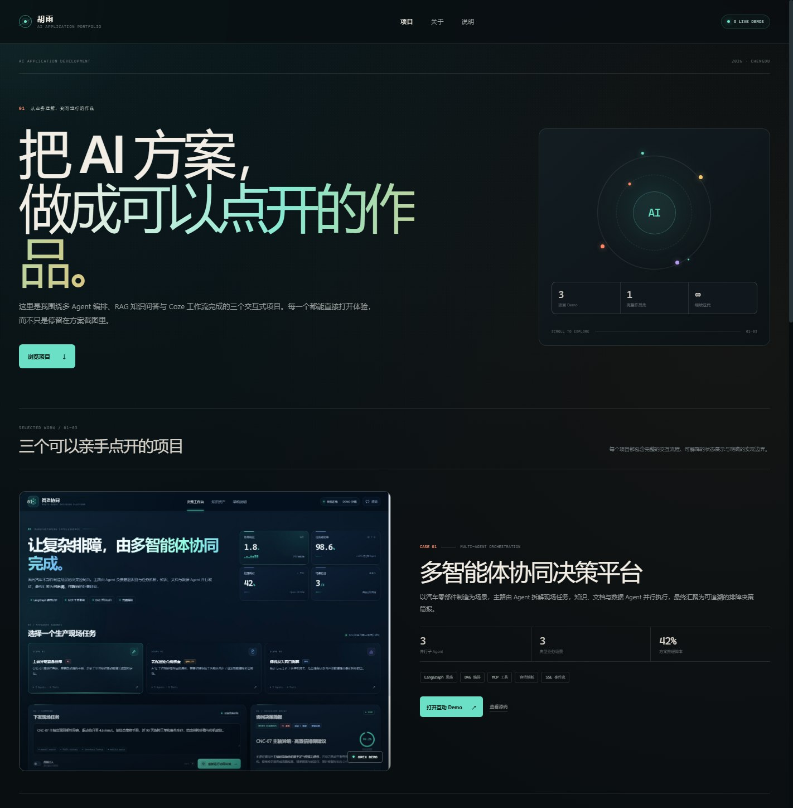

# 胡雨 · AI 应用开发作品集

三个可以直接打开体验的 AI 应用 Demo，集中展示多 Agent 编排、RAG 知识问答与 Coze 多工作流助手的产品交互能力。

> **在线作品集：** https://carrotrain4.github.io/ai-application-portfolio/



## 在线项目

| 项目 | 在线 Demo | 源码 |
| --- | --- | --- |
| 多智能体协同决策平台 | https://carrotrain4.github.io/multi-agent-decision-demo/ | https://github.com/carrotrain4/multi-agent-decision-demo |
| 企业 RAG 智能问答系统 | https://carrotrain4.github.io/rag-knowledge-demo/ | https://github.com/carrotrain4/rag-knowledge-demo |
| 人在旅途 AI 小助手 | https://carrotrain4.github.io/travel-ai-assistant-demo/ | https://github.com/carrotrain4/travel-ai-assistant-demo |

## 项目概览

### 01 · 多智能体协同决策平台

以汽车零部件制造为业务场景，主路由 Agent 识别现场任务并拆解 DAG，知识问答、文档处理与数据查询 Agent 并行执行，最后汇聚成带证据的维修决策简报。

- 实时协同拓扑与 SSE 事件流
- 故障注入、指数退避、缓存降级
- 熔断器 `CLOSED → OPEN → HALF_OPEN → CLOSED` 演练
- 引用证据、决策简报复制与 Markdown 下载

### 02 · 知序 · 企业 RAG 智能问答

面向制造企业知识孤岛，把 PDF / Word / PPT / 图片 / 邮件等异构知识统一接入，经过父子块切割、混合检索、BGE-Reranker 精排与 RAGAS 评估生成可信回答。

- 检索链路逐步可视化
- Top-3 语义块、父块上下文和 rerank 得分
- RAGAS 三维质量评估
- 低置信问题触发联网兜底与知识回流
- 本地文件上传模拟解析与索引

### 03 · 去野 · 人在旅途 AI 小助手

基于 Coze 多工作流思路搭建的旅行搭子，主调用 Agent 根据用户意图路由天气、Pose、语音故事、穿搭、朋友圈文案和行程规划工作流。

- 右侧主 Agent 路由轨迹
- 真实浏览器 Web Speech 语音故事
- 三种 SVG Pose 构图卡可切换
- 三套场景穿搭与行李清单
- 多语气朋友圈文案生成与复制

## 说明

三个项目均为**可交互前端原型**：Agent 编排、检索、路由与容错流程由浏览器内状态机模拟，业务数据均为虚构演示数据。生产版本可分别接入真实 LangGraph / RAG / Coze 服务。

## 本地预览

```bash
python -m http.server 8000
```

访问 `http://localhost:8000/`。

## 文件结构

```text
.
├── index.html
├── styles.css
├── app.js
├── favicon.svg
├── preview.jpg
├── assets/
│   ├── project-01.jpg
│   ├── project-02.jpg
│   └── project-04.jpg
├── .nojekyll
└── README.md
```

---

2026 · AI 应用开发作品集
